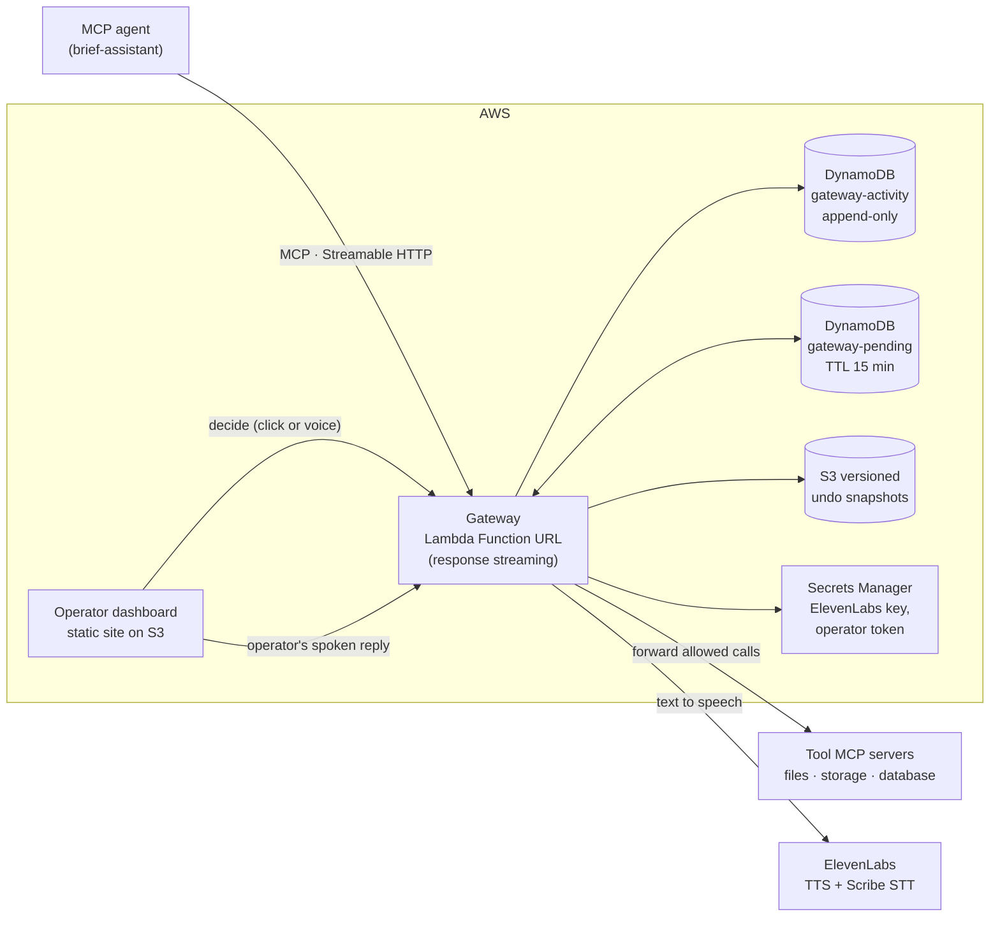

# Safe-Mode Gateway: architecture (hack day)

Safe-Mode Gateway is an MCP proxy that sits between an AI agent and its tools. Every tool call is classified (read, write, destructive) and checked against the operator's policy. Read calls run straight away. Write and destructive calls pause until a person decides, and every step goes into an append-only activity log.

The gateway runs on **AWS**: Lambda for the proxy, DynamoDB for the log, S3 for undo snapshots, Secrets Manager for keys. **ElevenLabs** gives it a voice: a paused call is read aloud to the operator, who can answer by voice.

> **Status:** this is the design for the 24-hour hack-day build. The demo video in this repo is an animated walkthrough of the flow.

## Diagram



## What each piece does

| Piece | Service | Job |
|---|---|---|
| Gateway | AWS Lambda (Node.js, Function URL, `RESPONSE_STREAM`) | MCP server toward the agent, MCP client toward the tools. It classifies each call, applies the policy, holds a paused call open, and forwards it or refuses it. |
| Activity log | DynamoDB `gateway-activity` | One item per event (`requested`, `decided`, `executed`, `undone`). The Lambda role can only `PutItem` with `attribute_not_exists`, so entries can't be edited or deleted. |
| Pending decisions | DynamoDB `gateway-pending` | One item per paused call: `pending`, then `approved`, `denied` or `timeout`. The waiting gateway polls it once a second; the dashboard writes the decision. |
| Undo snapshots | S3 bucket with versioning | Before a content-changing write, the gateway reads the file through the tool server and stores it here. Undo writes it back. |
| Secrets | Secrets Manager | The ElevenLabs API key and the operator token. Neither is ever sent to the browser or the agent. |
| Dashboard | S3 static site | Shows pending approval cards with Deny / Approve, plays the spoken card, records the operator's spoken reply, and shows the activity log. |
| Voice out | ElevenLabs text-to-speech | Reads the approval card aloud: "brief-assistant wants to delete the folder client-files, 3 items. Approve or deny?" |
| Voice in | ElevenLabs Scribe speech-to-text | Turns the operator's spoken reply into a decision (rules below). |
| Tool classes (stretch) | Amazon Bedrock | Suggests read / write / destructive for a tool the policy doesn't know. The operator confirms the suggestion; until then the tool counts as destructive. |

## Flows

**Read call (for example `search_files`)**
1. The agent calls the gateway, and the policy says `read`, so the call runs automatically.
2. The gateway forwards it, returns the result, and logs `requested` and `executed` (`decision: auto · read policy`).

**Write or destructive call (`rename_file`, `delete_folder`)**
1. The gateway logs `requested`, writes a `pending` item, and holds the agent's request open.
2. The dashboard shows the approval card: action, exact target, and which agent asked. The gateway has ElevenLabs speak the card and the dashboard plays it.
3. The operator clicks Deny or Approve, or answers by voice.
   - **Denied:** the agent gets an error result ("denied by operator") and the tool is never called.
   - **Approved:** before forwarding, the gateway records how to undo the call, then forwards it and logs `executed`.
4. No decision within 15 minutes (Lambda's limit) counts as **denied** and is logged as `timeout`.
5. While it waits, the gateway sends MCP progress notifications every 10 s. Agents that don't reset their own timeout on progress give up at their own limit (60 s in the MCP TypeScript SDK). For the live demo, decide within a minute or raise the agent's timeout.

**Undo**
- **rename:** the inverse rename, using the `original_name` recorded at approval.
- **content write:** writes back the S3 snapshot.
- **delete:** not undoable (no snapshot of whole folders), which is why destructive calls always pause.
- An undo is only offered when the target is still in the state the gateway left it (same name, same version). Otherwise it is refused and logged.

## Voice approval rules (ElevenLabs)

- The reply must be exactly "approve" or "deny", after lower-casing and removing punctuation. Anything else gets a spoken "Say approve or deny" and the card stays pending.
- Voice can **deny** anything and **approve** write calls. Approving a **destructive** call by voice still needs a click on Approve, so a misheard word can't delete data.
- Voice decisions are only accepted from a signed-in dashboard session (operator token). The voice itself is never treated as identity.
- The transcript is stored on the `decided` log entry (`via: voice`).
- The gateway calls ElevenLabs server-side with the key from Secrets Manager and caches each card's audio, so replaying it costs nothing.

## Activity log item

```json
{
  "workspace": "demo",
  "sk": "2026-11-29T10:02:31.120Z#call-0007#decided",
  "agent": "brief-assistant",
  "tool": "delete_folder",
  "args": { "path": "client-files" },
  "class": "destructive",
  "decision": "denied",
  "decidedBy": "operator",
  "via": "click",
  "outcome": "not executed"
}
```

## Policy

A JSON file deployed with the Lambda maps each tool to a class, and each class to `auto` or `pause`. Tools not listed are treated as destructive, so anything unknown pauses. The operator owns this file, and the agent has no tool that changes it.

## Security

- The agent endpoint (`/mcp`) and the operator endpoint (`/decide`, `/voice`) are separate paths with separate credentials. The agent can never approve its own calls.
- Function URLs use IAM auth or a bearer token checked first thing. For hack day that is one operator token; replace it with Cognito afterwards.
- Least-privilege IAM: the gateway can `PutItem` on the log, read and write `gateway-pending`, read and write the snapshot bucket, and read its two secrets. Nothing else.
- Every input from the agent is validated against the tool's JSON schema before it is classified or forwarded.

## Hack-day build order

1. Gateway proxy in Node.js with the MCP TypeScript SDK (stateless Streamable HTTP). Run it locally against one file-tools MCP server, with the policy and the auto/pause/deny paths.
2. DynamoDB `gateway-activity` and `gateway-pending`, and the dashboard reading them (cards, buttons, log).
3. Deploy to Lambda with a Function URL and response streaming (the AWS Lambda Web Adapter runs a normal Node HTTP server). If streaming under Lambda fights you, run the same container on ECS Fargate behind an ALB with a long idle timeout; nothing else changes.
4. ElevenLabs text-to-speech for the approval card, played on the dashboard.
5. ElevenLabs Scribe for spoken replies, with the rules above.
6. Undo: the inverse rename first, then S3 snapshots for content writes.
7. Stretch: Bedrock tool classification.

## Where the video shows it

- **"How it works":** the gateway on AWS Lambda, with the activity log on DynamoDB, undo on S3, and voice on ElevenLabs.
- **Approval cards:** a "Read aloud · ElevenLabs" chip while the card is spoken.
- **Activity log and undo record:** stored in DynamoDB.
- **Narrator:** the video's voiceover is ElevenLabs text-to-speech (the built-in "Jessica" voice).
