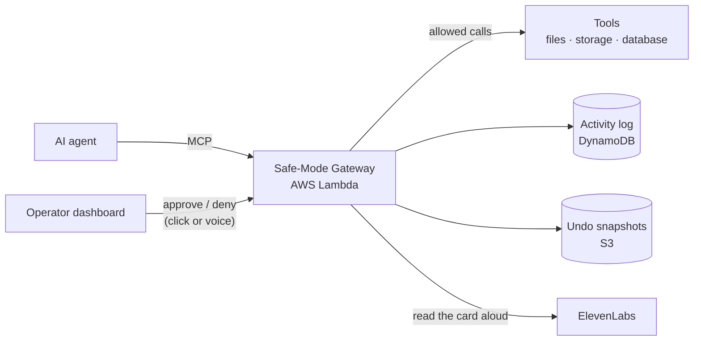

# Safe-Mode Gateway

**Let AI agents work in your team's tools without letting them break things.**

Safe-Mode Gateway sits between an AI agent and the tools it reaches through MCP (the Model Context Protocol). Every tool call is checked before it runs: reads go straight through, while writes and destructive actions pause until a person approves them. Approved changes can be undone, and every request, decision and result goes into an activity log the whole team can read.

Built for **wHACKiest 2026**, an online ideathon (26–27 Nov 2026), Track 1.

🎬 **Demo video:** a 5-minute walkthrough, attached to the [latest release](../../releases/latest).

## Problem

AI agents now act through tools: they search files, rename documents, write to databases and delete folders. Once an agent is connected to a tool, it can call any action that tool exposes, including ones nobody meant to allow for the task at hand.

- **Who it affects:** any team that connects agents to real workspaces, storage or databases.
- **Why it matters:** mistakes are real and fast. In July 2025, a widely reported incident saw Replit's AI coding agent delete a company's production database during a code freeze.
- **Gaps in today's options:**
  - Per-app approval prompts differ in every agent app, aren't shared as a team policy, leave no team-wide record, and can't undo anything.
  - Read-only sandboxes are safe, but the agent can't do useful work.
  - Full trust is fast, until something is gone.

## Solution

**One line:** a policy gateway for MCP that auto-allows safe calls, pauses risky ones for a human, can undo approved changes, and logs everything.

**Key features**
- **Three classes of tool call:** read, write and destructive. Unknown tools count as destructive.
- **Operator policy:** reads run automatically; writes and destructive calls pause for a decision.
- **Approval card:** shows the exact action, the exact target, and which agent asked.
- **Voice approvals (ElevenLabs):** the card is read aloud, and the operator can answer "approve" or "deny". Approving a destructive call still needs a click.
- **Undo:** reverses approved changes when the target is still in the expected state, such as a rename.
- **Activity log:** an append-only record of what was requested, what was decided, and what actually happened.

**User flow:** the agent asks to delete a folder, the gateway pauses the call, and the operator sees (and hears) the approval card. The operator denies it, the folder stays, and the log shows the request and the denial. A later rename is approved, runs, and is undone with one click.

**MVP (24 hours):** the gateway proxy with policy and pause/deny, the DynamoDB activity log, the operator dashboard, ElevenLabs read-aloud and spoken replies, and undo for renames. The full build order is in [ARCHITECTURE.md](ARCHITECTURE.md#hack-day-build-order).

## Tech stack

| Layer | Tool | Why |
|---|---|---|
| Gateway | Node.js + MCP TypeScript SDK on **AWS Lambda** (Function URL, response streaming) | Speaks MCP both ways; serverless, so there's nothing to run between demos |
| Activity log | **Amazon DynamoDB** (append-only) | Each event is one write; the gateway's IAM role can't edit or delete entries |
| Pending decisions | Amazon DynamoDB with TTL | Undecided calls expire and count as denied |
| Undo snapshots | **Amazon S3** with versioning | Lets content changes be restored |
| Secrets | AWS Secrets Manager | Keeps API keys out of the browser and away from the agent |
| Voice | **ElevenLabs** text-to-speech + Scribe speech-to-text | Reads approval cards aloud and takes spoken approve/deny |
| Dashboard | Static site on S3 | Approval cards, buttons, voice, and the log |
| Tool classes (stretch) | Amazon Bedrock | Suggests a class for unknown tools; the operator confirms |
| Demo video | Remotion (React) + VoiceStudio (local TTS) | The walkthrough in this repo |

## Architecture



Request flows, voice rules, the data model and security are in [ARCHITECTURE.md](ARCHITECTURE.md).

## What's new

| | Per-app prompts | Read-only sandbox | **Safe-Mode Gateway** |
|---|---|---|---|
| Agent can do real work | ✅ | ❌ | ✅ |
| One policy for every agent | ❌ | ✅ | ✅ |
| Exact action + target shown before it runs | Varies | n/a | ✅ |
| Team-wide activity log | ❌ | ❌ | ✅ |
| Undo approved changes | ❌ | n/a | ✅ (when reversible) |
| Hands-free approvals by voice | ❌ | ❌ | ✅ |

The new part is the combination. Because the gateway works at the MCP layer, one policy, one approval flow and one log cover every agent and every tool, with no changes to either.

## Impact & feasibility

- **Impact:** teams can give agents write access without betting the workspace on it, and when something goes wrong, the log answers what was tried, who allowed it, and what actually happened.
- **Feasibility:** it is a thin proxy plus two tables and a bucket, all on managed AWS services. The 24-hour MVP above fits that scope.
- **Risks and how they're handled:**
  - Agents can time out while a call is paused: the gateway sends progress pings, and an undecided call is denied after 15 minutes.
  - Spoken replies can be misheard: only exact "approve" or "deny" words count, and destructive approvals still need a click.
  - Not every action can be undone (for example, a sent email): those always pause for approval.

## This repo

The design is in [ARCHITECTURE.md](ARCHITECTURE.md). The demo video is a [Remotion](https://www.remotion.dev) project (1920×1080, 30 fps, 5 minutes) with an animated knight narrator.

```console
npm i
npm run dev                                   # Remotion Studio
npx remotion render SafeModeGatewayDemo out/safe-mode-gateway-demo.mp4
```

The narration text lives in `src/script.ts`. `node scripts/build-voice.mjs --force` rebuilds the voiceover with a local [VoiceStudio](https://github.com/debpalash/voicestudio) voice named "Knight narrator". Checks: `node scripts/check-narration.mjs`, `npx tsc --noEmit`, `npx eslint src`.

## Credits

The voiceover was generated locally with VoiceStudio using the OmniVoice model (k2-fsa/OmniVoice), whose weights are licensed CC-BY-NC, non-commercial. The knight is an original drawing.
