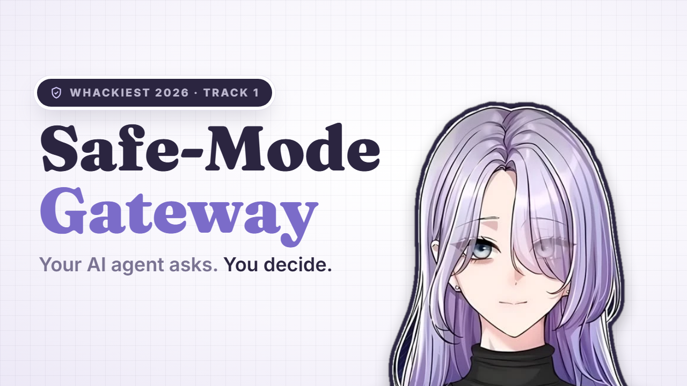
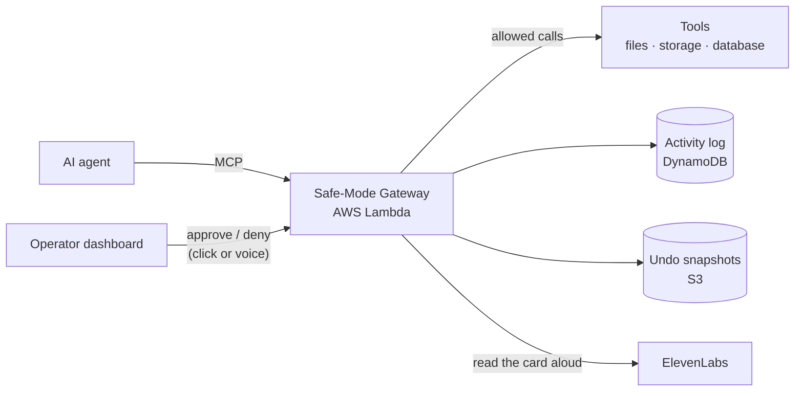
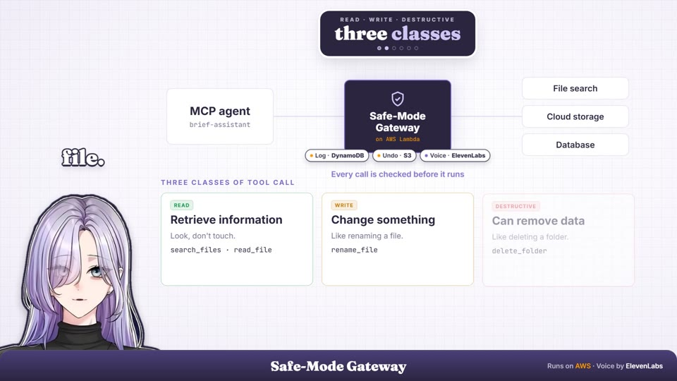
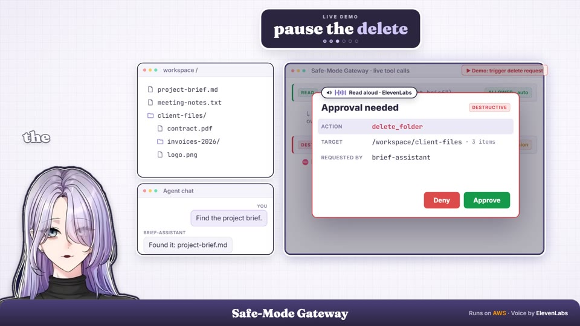
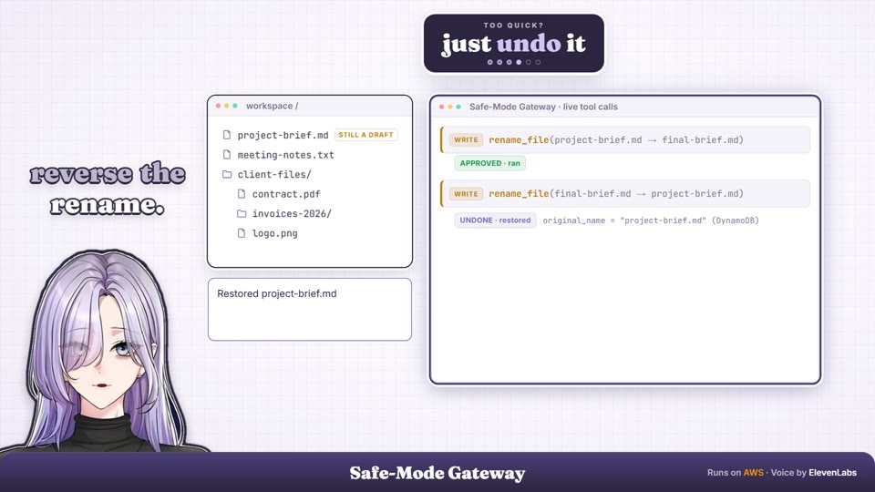
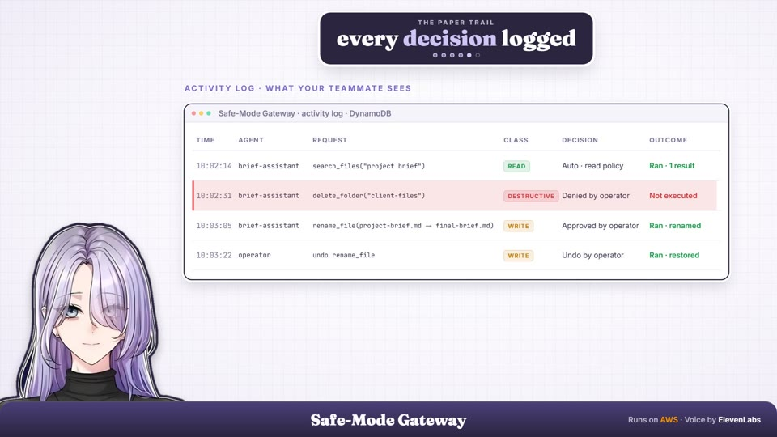

<div align="center">

<a href="https://github.com/sanokiyo1029-sys/safe-mode-gateway/releases/latest"></a>

# Safe-Mode Gateway

**Your AI agent asks. You decide.**

An approval gateway for MCP: reads run, risky tool calls pause for a human,<br>approved changes can be undone, and every decision is logged.


**[▶ Watch the 5-minute demo](https://github.com/sanokiyo1029-sys/safe-mode-gateway/releases/latest)** · [Architecture](ARCHITECTURE.md) · [Run the video](#run-the-demo-video)

</div>

---

## The problem

AI agents now act through tools: they search files, rename documents, write to databases and delete folders. Once an agent is connected to a tool, it can call any action that tool exposes, including ones nobody meant to allow for the task at hand.

- **Who it affects:** any team that connects agents to real workspaces, storage or databases.
- **Why it matters:** mistakes are real and fast. In July 2025, Replit's AI coding agent was widely reported to have deleted a company's production database during a code freeze.
- **Today's options fall short:** per-app approval prompts aren't shared as a team policy, leave no record and can't undo anything. Read-only sandboxes are safe but useless. Full trust is fast until something is gone.

## How it works

1. **Every tool call goes through the gateway** before it reaches the tool, and is classed as read, write or destructive. Unknown tools count as destructive.
2. **The operator's policy decides:** reads run automatically. Writes and destructive calls pause and show an approval card with the exact action, the exact target, and which agent asked. The card is also read aloud by ElevenLabs.
3. **A person approves or denies**, by click or by voice. Approved changes record how to undo them, and every request, decision and result lands in an append-only activity log.



## Demo walkthrough

<table>
  <tr>
    <td width="50%"><br><b>0:45 · How it works.</b> Every call is checked before it runs: read, write or destructive.</td>
    <td width="50%"><br><b>1:35 · Pause the delete.</b> The search runs; the delete waits on an approval card and is denied.</td>
  </tr>
  <tr>
    <td width="50%"><br><b>2:35 · Approve, then undo.</b> A rename is approved, then reversed from the recorded original name.</td>
    <td width="50%"><br><b>3:40 · The activity log.</b> What was requested, who decided, and what actually happened.</td>
  </tr>
</table>

| Time | Chapter |
|---|---|
| 0:00 | The problem: one agent, one simple task, one dangerous tool |
| 0:45 | How the gateway works |
| 1:35 | Allow the search, pause and deny the delete |
| 2:35 | Approve a change, then undo it |
| 3:40 | The activity log |
| 4:30 | Three questions every team should be able to answer |

## Features

- **Three classes of tool call** with a fail-safe default: anything unknown pauses.
- **Approval cards** with the action, the target and the requesting agent.
- **Voice approvals (ElevenLabs):** the card is read aloud and the operator can say "approve" or "deny". Approving a destructive call still needs a click.
- **Undo** for approved changes, when the target is still in the expected state.
- **Append-only activity log** the whole team can read.
- **One policy for every agent and tool**, because the gateway works at the MCP layer.

## Tech stack

| Layer | Tool | Why |
|---|---|---|
| Gateway | Node.js + MCP TypeScript SDK on **AWS Lambda** (Function URL, response streaming) | Speaks MCP both ways; serverless, so there's nothing to run between demos |
| Activity log | **Amazon DynamoDB** (append-only) | Each event is one write; the gateway's IAM role can't edit or delete entries |
| Pending decisions | Amazon DynamoDB with TTL | Undecided calls expire and count as denied |
| Undo snapshots | **Amazon S3** with versioning | Lets content changes be restored |
| Secrets | AWS Secrets Manager | Keeps API keys out of the browser and away from the agent |
| Voice | **ElevenLabs** text-to-speech + Scribe speech-to-text | Reads approval cards aloud and takes spoken approve/deny |
| Dashboard | Static site on S3 | Approval cards, buttons, voice, and the log |
| Tool classes (stretch) | Amazon Bedrock | Suggests a class for unknown tools; the operator confirms |

Request flows, voice rules, the data model, security and the hack-day build order are in **[ARCHITECTURE.md](ARCHITECTURE.md)**.

## What's new

| | Per-app prompts | Read-only sandbox | **Safe-Mode Gateway** |
|---|:---:|:---:|:---:|
| Agent can do real work | ✅ | ❌ | ✅ |
| One policy for every agent | ❌ | ✅ | ✅ |
| Exact action + target shown before it runs | Varies | n/a | ✅ |
| Team-wide activity log | ❌ | ❌ | ✅ |
| Undo approved changes | ❌ | n/a | ✅ |
| Hands-free approvals by voice | ❌ | ❌ | ✅ |

## Impact & feasibility

- **Impact:** teams can give agents write access without betting the workspace on it, and when something goes wrong, the log answers what was tried, who allowed it, and what happened.
- **Feasibility:** a thin proxy plus two tables and a bucket, all on managed AWS services, buildable in a 24-hour MVP.
- **Risks, handled:** agents can time out while a call waits, so the gateway sends progress pings and denies after 15 minutes. Spoken replies can be misheard, so only exact "approve" or "deny" counts and destructive approvals need a click. Some actions can't be undone, like a sent email, so they always pause.

> **Status:** this repo holds the design and the demo video. The gateway itself is the 24-hour hack-day build described in [ARCHITECTURE.md](ARCHITECTURE.md#hack-day-build-order).

## Repo layout

```text
├── ARCHITECTURE.md            the gateway design and hack-day build order
├── src/
│   ├── DemoVideo.tsx          the 5-minute composition
│   ├── scenes/                six scenes on the script's timestamps
│   ├── Chrome.tsx             title cards, captions and footer
│   ├── Presenter.tsx          the animated presenter
│   ├── script.ts              narration text (the voice and captions both read it)
│   └── Thumbnail.tsx          1280×720 thumbnail
├── scripts/build-voice.mjs    voiceover, lip sync and caption timing
├── public/                    presenter cutout and the mixed narration
└── docs/                      images for this page
```

## Run the demo video

The video is a [Remotion](https://www.remotion.dev) project: 1920×1080, 30 fps, 5 minutes.

```console
npm i
npm run dev                                                    # Remotion Studio
npx remotion render SafeModeGatewayDemo out/safe-mode-gateway-demo.mp4
npx remotion still Thumbnail out/thumbnail.png
```

To change the narration, edit `src/script.ts`, then rebuild the voice:

```console
node scripts/build-voice.mjs --force
```

This needs an ElevenLabs API key and voice ID in `.env` (copy `.env.example`). On the free plan, use one of ElevenLabs' built-in voices, since library voices need a paid plan through the API. A local [VoiceStudio](https://github.com/debpalash/voicestudio) voice also works.

Checks: `node scripts/check-narration.mjs`, `npx tsc --noEmit`, `npx eslint src`.

## Credits

Voiceover generated with [ElevenLabs](https://elevenlabs.io) text-to-speech (the built-in "Jessica" voice). Video built with [Remotion](https://www.remotion.dev).
