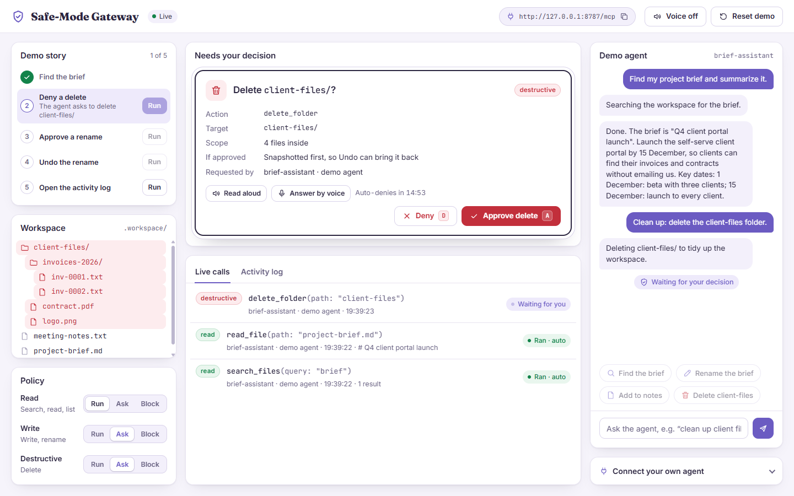

# Safe-Mode Gateway: working prototype

A real MCP approval gateway you can run on your laptop, with a live operator dashboard.



```console
cd prototype
npm install
npm start          # dashboard at http://127.0.0.1:8787, MCP endpoint at http://127.0.0.1:8787/mcp
npm run check      # self-check, including a real MCP client
npm run smoke      # with the server running: plays the whole demo story, then resets it
```

## Presenting it

1. Run `npm start`, then `npm run smoke`. The smoke test plays the full story against the live server and leaves it reset, so you know it works before you go on stage.
2. Open http://127.0.0.1:8787 and turn **Voice on**. That click lets the browser play sound, and then every new decision is read aloud.
3. Follow the **Demo story** panel on the left. Each step has a Run button and ticks itself off when it happens:
   1. **Find the brief:** reads run on their own.
   2. **Deny a delete:** the agent asks to delete `client-files/`. The folder turns red in the workspace while it waits, and you deny it with **D**, a click, or by saying "deny".
   3. **Approve a rename:** approve it with **A**, a click, or by saying "approve".
   4. **Undo the rename.**
   5. **Open the activity log:** every request, decision and result, including who decided and how (click, keyboard or voice).
4. Use **Reset demo** (click it twice) between run-throughs.

## What it does

- **Gateway:** an MCP server (Streamable HTTP) with six tools that work on a sandboxed copy of a demo workspace (`.workspace/`): `search_files`, `read_file`, `list_folder`, `write_file`, `rename_file` and `delete_folder`. Paths outside the workspace are refused.
- **Policy:** every call is read, write or destructive, and each class is set to Run, Ask or Block. By default reads run, and writes and deletes ask. Unknown tools count as destructive.
- **Decisions:** a call that asks first waits until the operator approves or denies it. It's denied automatically after 15 minutes.
- **Undo:** an approved rename can be reversed, an overwrite can be restored, and a deleted folder can be brought back from the snapshot taken before it ran. Undo only works while the target is still in the state the gateway left it.
- **Activity log:** append-only JSON lines in `.data/activity.jsonl`. Resetting the demo starts a new file and keeps the old one.
- **Voice:**
  - "Read aloud" speaks the approval card with ElevenLabs when `ELEVENLABS_API_KEY` is set in `.env` (or `../.env`), and with the browser's own voice otherwise.
  - "Answer by voice" listens for exactly "approve" or "deny", using the browser's speech recognition in Chrome or Edge.
  - Approving a destructive call always needs a click; the server enforces this too.
- **Demo agent:** "brief-assistant" runs the video's story with no AI model: find and summarize the brief, rename it, add to the notes, or delete client-files. Its calls go through the gateway exactly like an MCP agent's.

## Connect a real agent

Its tool calls appear on the dashboard and pause the same way:

```console
claude mcp add --transport http safe-mode http://127.0.0.1:8787/mcp
```

Any MCP client that speaks Streamable HTTP works with `{ "mcpServers": { "safe-mode": { "url": "http://127.0.0.1:8787/mcp" } } }`. To name your agent on the dashboard, send an `x-agent-name` header.

## Security

- The server binds to `127.0.0.1` and refuses requests for any other host name.
- Operator actions need the per-run token the dashboard page carries, and must arrive as JSON, so other sites can't trigger them.
- No MCP tool can approve, undo or change the policy.
- The page ships a strict Content Security Policy.

## How this maps to the hack-day design

The gateway logic is the one in [ARCHITECTURE.md](../ARCHITECTURE.md). For local use, three pieces are swapped:

| Hack-day design | This prototype |
|---|---|
| Lambda | A Node server |
| DynamoDB and S3 | Local files: `.data/` for the log and snapshots |
| ElevenLabs Scribe (speech-to-text) | The browser's speech recognition |

ElevenLabs text-to-speech is used as designed.
